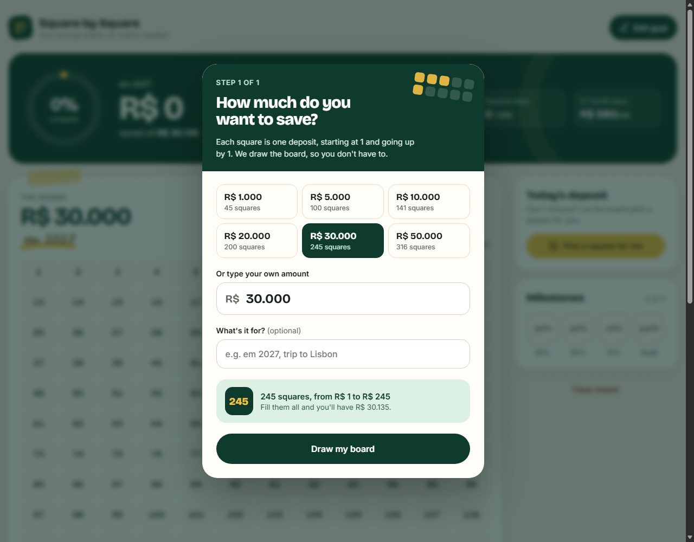

# Savings Challenge Board

## Idea

Square by Square turns a savings goal into a board of small deposits. Each numbered square represents that amount to save. Mark the squares as you go and see how much you have put aside.

## Main experience

- Set a savings goal and give it a name
- Mark deposits on the board and track the amount saved
- Pick an open square at random when you need a starting point
- See progress milestones and a suggested weekly pace
- Edit the goal or clear the board; progress is saved in your browser

## Tech

- HTML
- JavaScript
- Design prototype runtime with local React files

## Notes

This repository is a front-end prototype. Open `index.html` through a static web server, or deploy the folder to any static host. No build step is needed. Progress is stored in the browser's local storage, so it does not sync between devices.
